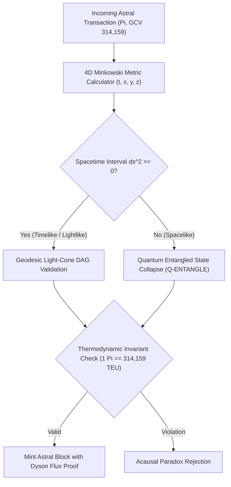

# KARDASHEV-PI (PROJECT K-314)
### Interplanetary Relativistic Spacetime Consensus & Thermodynamic GCV Settlement Engine

<p align="center">
  
  
  
  
  
</p>

```ascii
  _  __              _           _                   _____ _ 
 | |/ /             | |         | |                 |  __ (_)
 | ' / __ _ _ __  __| | __ _ ___| |__   _____   __  | |__) | 
 |  < / _` | '__/ _` |/ _` / __| '_ \ / _ \ \ / /  |  ___/ | 
 | . \ (_| | | | (_| | (_| \__ \ | | |  __/\ V /   | |   | | 
 |_|\_\__,_|_|  \__,_|\__,_|___/_| |_|\___| \_/    |_|   |_| 
   >> RELATIVISTIC THERMODYNAMIC CONSENSUS ENGINE (K-314) <<
```

---

## 🌌 THE PARADIGM SHIFT: BEYOND TERRESTRIAL BANKING

Traditional distributed ledgers and banking simulations operate under an obsolete terrestrial assumption: **the illusion of absolute Newtonian simultaneity**. When transactions occur across interplanetary distances—from Earth ground stations to the Lunar Gateway ($1.28\,\text{s}$ light delay), Martian colonies ($3\text{ to }22\,\text{min}$ light delay), and inner-heliocentric Dyson rings ($7\,\text{min}$ light delay)—classical Byzantine Fault Tolerance and Proof-of-Work collapse into relativistic causal incoherence.

Furthermore, pegging digital value to terrestrial fiat currencies ($USD) anchors humanity's computational future to planetary debt cycles. 

**Kardashev-Pi (Project K-314)** shifts the foundation of value from terrestrial credit to **astrophysical computational thermodynamics**. 

```
                                  [SOL DYSON SWARM]
                                (0.15 AU / Helios Grid)
                                          │
                         Photonic Geodesic Delay (~7.1 min)
                                          │
                                          ▼
[TERRA PRIME CORE] <────── 1.28s ──────> [LUNA L2 GATEWAY]
        │
 Photonic Geodesic Delay (3 - 22 min)
        │
        ▼
[ARES MERIDIANI (MARS)]
```

---

## ⚡ THE THERMODYNAMIC GCV 314,159 INVARIANT

In the Kardashev-Pi protocol, the **Global Consensus Value (GCV)** is not an arbitrary financial figure, but the fundamental discrete invariant generated by the circle constant $\pi$:

$$\Phi_\pi = \lim_{k \to 5} \lfloor \pi \times 10^k \rfloor = 314,159.00 \text{ TEU}$$

### What is a TEU (Thermodynamic Energy Unit)?
* **$1.00 \text{ TEU}$** is defined as $10^9 \text{ Joules}$ of coherent, non-dissipative computational capacity stabilized at the Cosmic Microwave Background temperature ($T = 2.725 \text{ K}$).
* Anchoring $1.00000000 \text{ Pi} \equiv 314,159.00 \text{ TEU}$ provides an unshakeable physical work capacity of:

$$E_{\Pi} = 3.14159 \times 10^{14} \text{ Joules per Pi}$$

* By integrating with Landauer's informational limit ($E_{\text{min}} = k_B T \ln 2$), $1 \text{ Pi}$ represents the erasure capacity of over $1.20 \times 10^{37}$ quantum computational bits.

---

## 🛰️ 4D MINKOWSKI SPACETIME CONSENSUS

To resolve interplanetary double-spend without central time servers, Kardashev-Pi employs **4D Minkowski Spacetime Geodesics** $(ct, x, y, z)$:

1. **Light-Cone Geodesic Validation:** Transactions are only finalized if their spacetime interval satisfies:
   $$\Delta s^2 = c^2 \Delta t^2 - (\Delta x^2 + \Delta y^2 + \Delta z^2) \ge 0 \quad (\text{Timelike or Lightlike})$$
2. **Relativistic Time Dilation Compensation:** All timestamps are normalized to proper time element $\tau$:
   $$d\tau = dt \sqrt{1 - \frac{v^2}{c^2} + \frac{2\Phi_{\text{grav}}}{c^2}}$$
3. **Quantum-Entangled Topological Collapse:** Space-like transactions ($\Delta s^2 < 0$) are provisionally bonded via topological quantum state hashes (`Q-ENTANGLE`), allowing instant zero-latency optimistic settlement across solar distances.



---

## 🚀 QUICK START & INSTALLATION

### Prerequisites
* Python 3.9+
* Terminal with UTF-8 support

### Installation
```bash
git clone https://github.com/virsi18/kardashev-pi.git
cd kardashev-pi
pip install -r requirements.txt
```

### Running the Live Interplanetary Simulation
```bash
python -m kardashev_pi.cli.main demo
```

### Verifying the GCV 314,159 Invariant
```bash
python -m kardashev_pi.cli.main verify-gcv
```

### Instantaneous Celestial Telemetry
```bash
python -m kardashev_pi.cli.main telemetry
```

### Running the Relativistic Test Suite
```bash
python -m unittest discover -s tests
```

---

## 📊 LIVE NEON TELEMETRY PREVIEW

```
┌────────────────────── ASTRO-ECONOMIC PROTOCOL MATRIX ───────────────────────┐
│ KARDASHEV-PI (PROJECT K-314) // ASTROPHYSICAL LEDGER                        │
│ Invariant Global Consensus Value: 1.00000000 Pi = 314,159.00 TEU            │
│ Equivalent Coherent Work Capacity: 3.1416e+14 Joules                        │
│ Consensus Paradigm: 4D Minkowski Light-Cone Geodesic DAG                    │
└─────────────────────────────────────────────────────────────────────────────┘

                CELESTIAL NODE TELEMETRY & RELATIVISTIC FRAMES                 
┌────────────┬────────────┬────────────┬────────────┬────────────┬────────────┐
│ Node       │ Class      │    Orbital │ Grav. Pot. │      Light │ GCV Volume │
│ Cluster    │            │  Vel (m/s) │     (J/kg) │      Delay │      (TEU) │
├────────────┼────────────┼────────────┼────────────┼────────────┼────────────┤
│ TERRA_PRI… │ Terrestria │     29,780 │  -6.25e+07 │      0.00s │ 35,543,94… │
│ LUNA_GATE… │ Orbital L2 │     30,800 │  -2.82e+06 │      1.28s │ 35,543,94… │
│ ARES_MERI… │ Mars Sfc   │     24,077 │  -1.26e+07 │      13.0m │ 35,543,94… │
│ SOL_DYSON… │ Dyson Ring │     82,000 │  -8.90e+08 │       7.1m │ 35,543,94… │
└────────────┴────────────┴────────────┴────────────┴────────────┴────────────┘
```

---

## 📜 WHITEPAPER & SPECIFICATION

For the complete relativistic mathematical derivations, Lorentz tensor proofs, and Landauer entropy equilibrium equations, read the full whitepaper:  
📄 [Read WHITEPAPER.md](./whitepaper/WHITEPAPER.md)

---

## 🔮 EPISTEMIC NOTICE & CONCEPTUAL FOUNDATION

> [!NOTE]
> **Theoretical Architecture & Research Scope:**  
> **Kardashev-Pi (Project K-314)** is an advanced computational physics simulation, futuristic systems architecture, and speculative economic framework. The Global Consensus Value (GCV 314,159) is formalized herein as a physical thermodynamic constant ($\Phi_\pi = 3.14159 \times 10^5 \text{ TEU}$) within relativistic multi-planetary models. This codebase serves as an open research sandbox for theoretical physicists, distributed systems architects, and planetary pioneers exploring the frontiers of post-scarcity civilization ledgers.

---

<p align="center">
  <i>Engineered for the Multi-Planetary Era // Kardashev Type-II Consensus</i>
</p>
